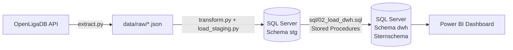
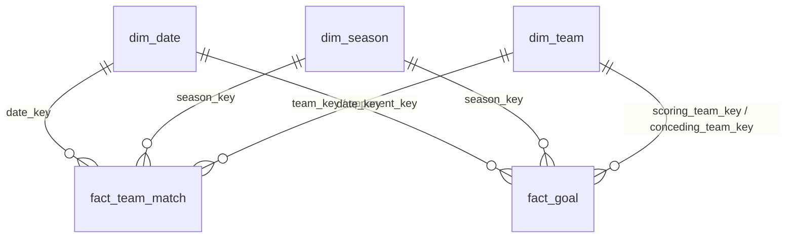

# MSV Duisburg Analytics

Eine kleine, vollständige Business-Intelligence-Strecke: Spieldaten des MSV Duisburg (3. Liga) werden per API geladen, in **SQL Server** in ein **Sternschema** überführt und mit **Power BI** ausgewertet. Die komplette Pipeline läuft mit einem Befehl.

> Inoffizielles Hobby- und Lernprojekt ohne Verbindung zum MSV Duisburg oder zu anderen genannten Organisationen. Datenquelle: [OpenLigaDB](https://www.openligadb.de) (öffentliche API).

## Fragestellungen

- Wie entwickeln sich Punkte, Tore und Tabellenplatz im Saisonverlauf?
- Heim vs. Auswärts: Wo holt der MSV mehr Punkte?
- Wie ist die Form (Punkte der letzten 5 Spiele)?
- Wann fallen Tore (Torminuten, Nachspielzeit, Elfmeter)?

## Architektur



| Schicht | Aufgabe |
|---|---|
| Extract (`src/extract.py`) | Spiele je Saison von der API abrufen und unverändert als JSON speichern |
| Staging (`stg`) | Rohdaten flach in Tabellen, kaum bearbeitet |
| Data Warehouse (`dwh`) | Fachliche Logik (Punkte, Heim/Auswärts, Saisonstatus) per T-SQL, Sternschema |
| Reporting | Views mit Window Functions, Power-BI-Modell |

## Datenmodell



Wichtige Entwurfsentscheidungen:

- **Granularität von `fact_team_match`: eine Zeile pro Team und Spiel** (jedes Spiel erscheint zweimal, je Team-Sicht). Fragen wie „Punkte des MSV zuhause" werden dadurch zu einem einfachen `SUM` mit Filter, ohne Fallunterscheidung „war der MSV Team 1 oder Team 2?".
- **Role-Playing Dimension:** `dim_team` wird als `team_key` und `opponent_key` genutzt.
- **Saisonstatus in `dim_season`** (abgeschlossen / laufend / unvollständig): lückenhafte Quelldaten werden sichtbar, statt falsche Tabellen zu liefern.
- **Staging und DWH getrennt:** `stg.match` bleibt Rohdatenablage. Die Regel „nur Spiele mit zwei echten Teams" steckt in der View `stg.v_match_valid`, abgelehnte Spiele sind in `sql/04_checks.sql` einsehbar.
- **Ladeprozeduren laufen in einer Transaktion:** entweder wird alles geladen oder bei einem Fehler nichts.
- **Full Rebuild:** `python src/pipeline.py` baut Tabellen und Daten bei jedem Lauf komplett neu auf und ist damit beliebig wiederholbar.

## Schnellstart

### Voraussetzungen

- [Docker Desktop](https://www.docker.com/products/docker-desktop/) (oder Docker Engine)
- Python 3.11 oder neuer
- [Microsoft ODBC Driver 18 for SQL Server](https://learn.microsoft.com/sql/connect/odbc/download-odbc-driver-for-sql-server)
- Optional: [Power BI Desktop](https://powerbi.microsoft.com/desktop/) (nur Windows) für das Dashboard, außerdem SSMS, Azure Data Studio oder die VS-Code-Erweiterung „SQL Server (mssql)", um in die Datenbank zu schauen

### Schritte

```bash
# 1. Repository holen
git clone https://github.com/pmprzr/msv-analytics.git
cd msv-analytics

# 2. Zugangsdaten anlegen und das Passwort in .env anpassen
cp .env.example .env

# 3. SQL Server in Docker starten
docker compose up -d

# 4. Python-Umgebung einrichten
python -m venv .venv
source .venv/Scripts/activate      # Windows Git Bash
# .venv\Scripts\Activate.ps1       # Windows PowerShell
# source .venv/bin/activate        # macOS / Linux
pip install -r requirements.txt

# 5. Komplette Pipeline ausführen (ca. 1 Minute)
python src/pipeline.py
```

Am Ende gibt die Pipeline Datenqualitäts-Checks aus: Zeilenzahlen, Saisonstatus, Abstimmung zwischen Staging und DWH sowie die Tabelle 2025/26.

**Verbindung zur Datenbank** (SSMS, Power BI, ...): Server `localhost,1433`, Datenbank `msv_dwh`, Benutzer `sa`, Passwort aus `.env`. Bei selbstsigniertem Zertifikat „Serverzertifikat vertrauen" aktivieren.

### Nützliche Varianten

```bash
python src/pipeline.py --skip-extract          # vorhandene Rohdaten wiederverwenden
python src/pipeline.py --seasons 2025 2026     # nur bestimmte Saisons laden
python src/db.py sql/04_checks.sql             # nur die Checks erneut ausführen
docker compose down                            # Datenbank stoppen (Daten bleiben erhalten)
docker compose down -v                         # Datenbank stoppen und Daten löschen
```

## Projektstruktur

```
msv-analytics/
├── README.md
├── docker-compose.yml        SQL Server 2022 (Developer Edition) in Docker
├── requirements.txt          Python-Pakete
├── .env.example              Vorlage für Zugangsdaten (.env ist nicht im Repo)
├── src/
│   ├── pipeline.py           startet alles in der richtigen Reihenfolge
│   ├── extract.py            API -> data/raw/*.json
│   ├── transform.py          JSON -> flache Tabellen (pandas), ohne Datenbank testbar
│   ├── load_staging.py       Tabellen -> stg.match / stg.goal
│   ├── db.py                 Verbindungen, führt .sql-Dateien aus
│   └── config.py             Einstellungen (Saisons, Liga, Pfade)
├── sql/
│   ├── 00_create_database.sql   Datenbank anlegen
│   ├── 01_create_tables.sql     Schemata, Staging-Tabellen, Sternschema
│   ├── 02_load_dwh.sql          alle Ladeprozeduren (stg -> dwh)
│   ├── 03_views.sql             Tabelle und Form (Window Functions)
│   └── 04_checks.sql            Datenqualität und Abstimmung
├── tests/                    pytest für die Transformationslogik
├── dashboard/                Power-BI-Datei und Screenshots
└── data/raw/                 API-Rohdaten (nicht im Repo, werden erzeugt)
```

## Datenqualität: was die Quelldaten mitbringen

Beim Aufbau sind folgende Auffälligkeiten aufgetreten. Die Pipeline behandelt sie bewusst und nachvollziehbar, statt sie zu verstecken:

| Befund | Umgang damit |
|---|---|
| Platzhalter-Spiel ohne echte Teams (`team_id = 0`, kein Name, Datum außerhalb der Saison) | Wird durch `stg.v_match_valid` abgelehnt, bleibt im Staging sichtbar (Check 4) |
| Saison 2022 enthält nur 211 statt 380 Spielen (davon 210 gültig) | `season_status = 'unvollständig'` in `dim_season` |
| Die Quelle liefert keine Zuschauerzahlen (`numberOfViewers` durchgehend leer) | Keine Zuschauer-Auswertung; Spalte bleibt im Staging für spätere Quellen |
| Reihenfolge von Halbzeit- und Endergebnis wechselt zwischen Saisons | Zuordnung über `resultTypeID` statt über die Reihenfolge, per Test abgesichert |
| Zeitstempel mal mit, mal ohne Millisekunden | Parsing als ISO 8601, per Test abgesichert |
| Bei manchen Toren fehlen Torschütze und Minute | Bleiben `NULL`; Abgleich Torliste vs. Endergebnis in Check 6 |
| In der Liga-Datei der Saison 2024 kommt der MSV nicht vor | Saison wird geladen, taucht in MSV-Auswertungen nicht auf |
| Torlisten unvollständig, bei vielen Toren fehlt die Minute | Auswertung der Torminuten nur für Tore mit bekannter Minute; die Karte „Tore ohne Minute“ zeigt den Anteil |

## Ergebnisse

_TODO: Hier 3 bis 4 konkrete Erkenntnisse aus den Daten eintragen (z. B. Heim- vs. Auswärtspunkte je Saison), sobald das Dashboard steht. Screenshots liegen in [`dashboard/`](dashboard/)._

**Validierung:** _TODO: Tabelle 2025/26 aus Check 7 mit einer öffentlichen Tabelle abgleichen und das Ergebnis hier festhalten._

## Tests

```bash
pip install pytest
pytest
```

## Fehlerbehebung

| Meldung | Ursache und Lösung |
|---|---|
| `Data source name not found` | ODBC Driver 18 for SQL Server fehlt. Installieren, danach prüfen: `python -c "import pyodbc; print(pyodbc.drivers())"` |
| `Login failed for user 'sa'` | Passwort in `.env` passt nicht zu dem, mit dem der Container erstmals gestartet wurde. Lösung: `docker compose down -v`, dann `docker compose up -d` |
| SQL Server nicht erreichbar | Container läuft nicht: `docker compose ps` und `docker compose logs sqlserver` |
| Port 1433 belegt | In `.env` `MSSQL_PORT=14330` setzen und Container neu starten |
| `ModuleNotFoundError: dotenv` | Virtuelle Umgebung ist nicht aktiv (`source .venv/Scripts/activate`) oder `pip install -r requirements.txt` fehlt |
| Apple-Silicon-Mac | Das SQL-Server-Image ist für x86; in Docker Desktop die Emulation (Rosetta) aktivieren |

## Mögliche Erweiterungen

- Zuschauerzahlen aus einer zweiten Quelle (z. B. gepflegte CSV) ins DWH integrieren
- Inkrementelles Laden statt Full Rebuild
- Automatische Aktualisierung per GitHub Action
- Tabular Model in Analysis Services statt Power-BI-internem Modell

## Quellen

Spieldaten: [OpenLigaDB](https://www.openligadb.de), abgerufen über die öffentliche API (`api.openligadb.de`).
